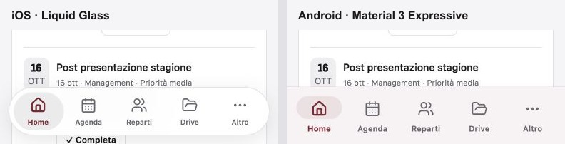

# Verifica locale — 17 ottobre 2026

## Stato delle cinque fasi

1. Mappa, bozzetti strutturali e direzione visiva: documentati in `README.md`; cinque schermate implementate e fotografate nel browser.
2. Struttura mobile: barra inferiore, intestazioni con ritorno al livello superiore, separazione dal desktop, safe area e componenti comuni implementati.
3. Flussi: Home operativa, agenda per giorno, indice reparti e Altro, liste dedicate per sponsor/costi/contratti, filtri in pannello, editor a schermo intero e menu Drive implementati. Recruiting e modifica delle pagine conservano i flussi esistenti e ricevono la nuova struttura mobile.
4. PWA: manifest standalone, icone, installazione guidata, fallback offline pubblico e aggiornamento su scelta dell'utente implementati.
5. QA locale eseguita. Collaudo su dispositivo iPhone fisico e installazione sul dominio HTTPS pubblicato ancora da eseguire.

## Controlli automatici

- `npm test`: **72 test superati**, inclusi tre nuovi test del service worker.
- `npm run typecheck`: superato anche dopo il ripristino dei file generati dall'anteprima.
- `NEXT_PUBLIC_DATA_MODE=demo CRM_BUILD_DIR=/tmp/sft-crm-mobile-build npm run build`: build di produzione superata.
- `git diff --check`: superato.
- Manifest servito con HTTP 200 e MIME `application/manifest+json`, display `standalone`, scope `/` e tre icone.
- Service worker servito con HTTP 200 e `Cache-Control: no-cache, no-store, must-revalidate`.
- Icone PNG verificate: 192×192, 512×512 e Apple touch icon 180×180.
- Rosso del tema scuro verificato contro sfondo, card, popover e testo del pulsante; contrasto almeno 4.5:1 su queste coppie. Il bordeaux chiaro su bianco supera 9:1.

## Controlli nel browser sulla build di produzione

Browser in-app sul Mac con viewport impostato; dati esclusivamente demo.

| Controllo | Esito |
| --- | --- |
| Home, Agenda, Reparti, Drive, Altro a 320 px | Tutte raggiungibili; `scrollWidth === innerWidth === 320` |
| Composizione a 390×844 | Verificata nei temi chiaro e scuro; anteprime salvate |
| Dettaglio di reparto a 390 px | Pagina, editor e risorse raggiungibili; nessun overflow della pagina |
| Sponsor e contratti a 320 px | Liste dedicate caricate e raggiungibili |
| Bilancio a 320 px | Lista dedicata, riepiloghi e filtri raggiungibili; nessun overflow della pagina |
| Modulo delivery a 390×844 | Dialog largo 390 e alto 844, campi e comandi visibili |
| Creazione delivery demo | Creata “Verifica mobile PWA”, cercata, riaperta e archiviata tramite conferma |
| Filtri Agenda | Pannello dal basso con selezioni e comando di chiusura verificato |
| Menu Drive | Apertura azioni della cartella verificata; operazioni reali di Drive non eseguite |
| Scorrimento tra tab | Home → Drive → Home: posizione ripristinata a 844 px dopo il rendering |
| Recruiting | Accesso alla demo e scheda candidato fittizio verificati a 390 px |
| Desktop a 1440 px | Sidebar visibile, tabbar nascosta, Home originale presente, nessun overflow |
| Tabelle desktop | Bilancio conserva una tabella e non monta la lista mobile |
| Azioni Drive desktop | Menu aperti con comandi direttamente visibili |
| Errori console | Nessun errore osservato nella verifica finale |
| Offline reale del server | Server locale fermato: navigazione mostra “Ritroviamoci online” dalla cache pubblica |
| Riconnessione | Server riavviato, “Riprova” riapre il workspace |
| Primo avvio PWA | Corretto l'avviso di aggiornamento transitorio; assente dopo la correzione |

Le schede Management scorrono orizzontalmente nel proprio contenitore. Il documento non produce scorrimento orizzontale nei viewport controllati.

## Anteprime

- [Home chiara](home-light.jpg) e [Home scura](home-dark.jpg)
- [Agenda](agenda-light.jpg)
- [Reparti](reparti-light.jpg)
- [Drive](drive-light.jpg)
- [Altro](altro-light.jpg)
- [Desktop](desktop-dark.jpg)
- [Offline](offline.jpg)

## Limiti e rilascio

Non sono stati eseguiti push o deploy. Le modifiche restano nel checkout locale. I dati e gli asset già modificati prima del lavoro sono stati conservati; `next-env.d.ts` è tornato esattamente allo stato iniziale e i percorsi temporanei aggiunti da Next sono stati rimossi da `tsconfig.json`.

La verifica su viewport mobile non equivale a un test su iPhone fisico. Restano da controllare Safari e installazione dalla schermata Home sul dominio HTTPS, tastiera software, safe area fisiche, rotazione, ritorno dall'app in background e sessione autenticata reale. Le integrazioni Google/Drive/Calendar e le operazioni sui dati condivisi non sono state collaudate live durante questo lavoro. Non è stata effettuata una simulazione end-to-end di aggiornamento da una release pubblicata a un'altra.

## Aggiornamento navbar iOS / Android

La barra mobile ora adatta il linguaggio visivo alla piattaforma: capsula flottante con sfocatura, bordo e selezione scorrevole su iOS; superficie Material 3 con indicatore a pillola sull'icona per Android. I cinque collegamenti rimangono visibili. La scelta automatica usa l'identificazione Android del browser; sui browser non Android usa la variante Apple. In Altro → Preferenze → Barra di navigazione è possibile scegliere una variante esplicita. Viene conservata soltanto questa preferenza di interfaccia; nessun dato del team.

Riferimenti ufficiali consultati:

- [Apple: design kit iOS 27](https://developer.apple.com/news/?id=e2lxw9l1)
- [Apple: tab bar e Liquid Glass](https://developer.apple.com/design/human-interface-guidelines/tab-bars)
- [Google: Material 3 Expressive e componenti di navigazione](https://developer.android.com/develop/ui/compose/designsystems/material3)

Adattamento web dei linguaggi visivi: non vengono utilizzati componenti UIKit o Jetpack Compose nella PWA.

Verifiche aggiuntive: TypeScript e build di produzione superati; iOS e Android selezionabili nel browser, persistenza dopo ricaricamento, temi chiaro e scuro, tutti e cinque i tab iOS verificati a 320 px con indicatore corrispondente alla destinazione. Entrambi gli stili a 320 px mantengono `scrollWidth === innerWidth` e target superiori a 44×44 px. A 1440 px la tabbar rimane nascosta e la sidebar visibile. Nessun errore console osservato. Implementati fallback opachi per contrasto elevato/trasparenze ridotte e riduzione delle animazioni secondo le preferenze di sistema; queste preferenze non sono state emulate nel browser durante la verifica.

Il riconoscimento automatico su Android fisico e la resa su iPhone fisico restano da verificare. Nessun push o deploy.

